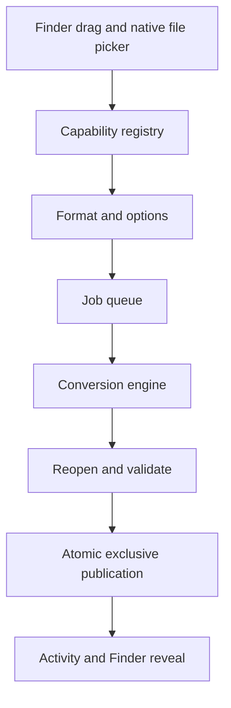

# Architecture and roadmap

File Converter is a native macOS utility for local conversion, editing and file actions. The current release is an image-conversion foundation; this document describes future work as well as the architecture already taking shape.

## Product behavior

- Hold Shift while dragging an image in Finder to reveal a conversion wheel around the file. Drop onto an available format to convert.
- Offer only operations supported for the entire selection and by the installed conversion engines.
- Keep originals intact, validate outputs, and save results beside the originals under non-conflicting names.
- Keep processing local, report partial batch failures, and make saved results easy to reveal in Finder.
- Provide a file-picker and keyboard-accessible alternatives to the radial gesture.

## Structure

`ConverterCore` contains format capabilities, conversion requests/results, gesture state, wheel hit testing, image conversion and atomic publishing. It is shared by the native application and the command-line tool. The application uses SwiftUI for its workspace and settings, and AppKit for the menu bar, drag destinations, nonactivating wheel panels and native pickers.

The current engine runs in a serial actor within the app process. The next execution layer should isolate expensive/untrusted parsing in restricted workers and add persistent job state. Each worker should accept a versioned request, enforce resource limits, emit progress, and return an output manifest. External tools must receive argument arrays rather than shell command strings.

## Milestones

### 1. Desktop and execution foundation

Already implemented: menu-bar lifecycle, workspace, image picker/drop area, native wheel, shared capabilities, batch queue, Activity, settings, image validation and exclusive publication.

Remaining work:

- Validate the physical Finder Shift-drag gesture, including Shift before/during drag, modifier release, Escape, centre/outside drops, Spaces and multiple displays.
- Add worker isolation, memory-pressure handling and crash/interrupted-job recovery.
- Improve folder-grant status, stale-bookmark recovery and revocation.
- Test accessibility, Reduce Motion, minimum supported macOS and clean-machine packaging.
- Add login launch and configurable wheel modifiers.

### 2. Images and PDF

- Add independently built WebP encoding and a tested compatibility matrix.
- Add preset and target-size compression with measured output limits and clear failure when a target cannot be reached.
- Add crop, adjustments, annotation, backgrounds and collage using shared preview/export geometry.
- Add dedicated metadata editing/removal and privacy verification, including HEIC/HDR/portrait cases.
- Add solid/blur image redaction and QR reading with explicit input limits.
- Add PDF input, all-page image export, split, merge, page organization and aggregate image-to-PDF creation.
- Preserve or explicitly reject animation, alpha, profile and multi-page features that a destination cannot represent.

### 3. Audio and video

- Introduce a pinned, independently built media engine with verified codecs and filter capabilities.
- Add audio/container conversion, video conversion, audio extraction and GIF output.
- Add trim, crop, speed, mute, joins, snapshots and split/rejoin operations.
- Add loudness normalization, channel conversion, silent-end trimming, bleep ranges and visualizations.
- Make previews cancellable; validate timestamps, duration, tracks, synchronization and actual target sizes.

### 4. Documents, EPUB and Office

- Build a structured document model for paragraphs/runs, lists, tables, images, links, sections, notes, headers/footers and styles.
- Implement text/Markdown, DOCX, RTF/RTFD, Pages and EPUB adapters and HTML/PDF/image output.
- Keep page-preservation and editable PDF reconstruction distinct. Add OCR and reading-order/table analysis with a declared loss report.
- Use offline rendering with bounded XML, package and artwork processing. Reject unsafe paths, external resources and unsupported encrypted content.
- Evaluate upstream open-source Pages and Office libraries against a generated corpus. Track their versions and licenses independently.
- Add presentation rendering, page-image slides, spreadsheet conversion/rendering and text-based PDF table extraction with explicit formula, sheet and unsupported-content semantics.

### 5. Archives, subtitles and file actions

- Add ZIP/TAR/GZIP conversion and extraction, plus RAR reading through a tested upstream archive engine.
- Reject extraction paths/links that escape the output root and enforce expansion/member limits.
- Add SRT/VTT parsing/conversion and text export with validated cue timing.
- Add AirDrop, file/path clipboard operations, deliberate moves, Terminal integration and floating file shelves.
- Define aggregate versus per-file behavior and cross-volume/conflict handling explicitly.

### 6. Distribution and compatibility

- Add reproducible signed/notarized release packaging and verify helper integrity.
- Test supported capabilities on clean machines without developer tools or optional local dependencies.
- Maintain generated capability documentation from the same registry used by the UI and tests.
- Ship a clear limitations list. A supported extension alone must not imply support for every embedded feature or codec.

## Verification approach

Use immutable generated or permission-cleared fixtures. Each conversion should validate expected output type/cardinality, independently reopen the result, preserve the original and report unsupported features clearly. Lossy output needs measured/perceptual tolerances; lossless data needs decoded-content comparisons.

Core failure coverage should include malformed packages, orientation/alpha, multi-page content, mixed selections, stale grants, filename races, disk/permission failures, source changes, cancellation and worker crashes. Media coverage should include variable frame rate, silent clips, rotated/odd dimensions, differing channel layouts and high sample depths. Document coverage should include scanned/RTL/multicolumn text, merged cells, formulas, embedded artwork and missing external resources.

New functionality should be marked supported only after its baseline corpus and failure cases pass. The current build's exact scope and verification are recorded in [IMPLEMENTATION.md](../IMPLEMENTATION.md).
